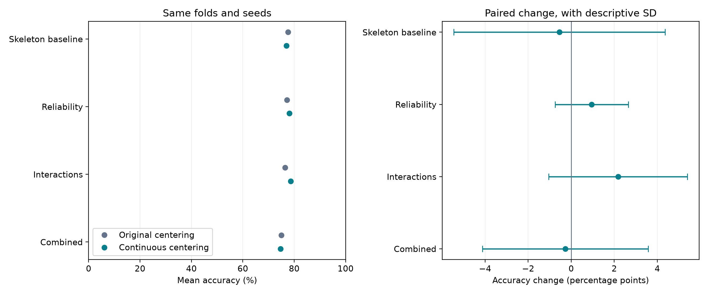

# Continuous hip-centering correction

Recorded 2026-11-15.

Missing hip origins use an interpolated hip-to-box offset within continuous observed track segments. Reliable hip origins, no-hip fallback, network size and initialization are preserved.

Matched 245 unique clips, 204 reviewed source groups, 5 folds and seeds [42, 123, 2026].
Raw pose/motion inputs, splits, training budget and nominal parameter counts match. Only the derived centering definition changes. Scaling, checkpoint selection and thresholds are fitted afresh using training and validation data.

| Model | Original centering | Continuous centering | Accuracy change (pp) | Macro-F1 change | AUC change | Improved/tied/worse runs |
|---|---:|---:|---:|---:|---:|---:|
| Skeleton baseline | 77.6% | 77.0% | -0.54 | -0.0075 | -0.0044 | 5/4/6 |
| Reliability | 77.1% | 78.1% | +0.95 | +0.0080 | -0.0006 | 8/5/2 |
| Interactions | 76.5% | 78.6% | +2.18 | +0.0228 | -0.0050 | 7/7/1 |
| Combined | 75.0% | 74.7% | -0.27 | -0.0051 | -0.0011 | 5/6/4 |

Changes are continuous centering minus original centering. The unchanged linear controls reproduce identical held-out scores and decisions.

Exploratory paired comparison on previously inspected footage. Fold/seed observations are dependent; deviations and win counts are descriptive, not confidence intervals or significance tests. Interpolation uses the whole clip and can still be affected by box jitter, incorrect joints and track errors. Detection masks and confidence remain available. A feature correction does not prove external generalization.

Both experiments were verified from saved fits: 70 reference and 70 ablation fits. The reference artifacts were read without modification.

TCN scores were reproduced on cpu; verification implementation hashes are recorded separately. Training devices and package versions match for each pair.

[Detailed comparison](centering_comparison.json) | [Paired runs](centering_paired_runs.csv) | [Experiment results](index.html)
