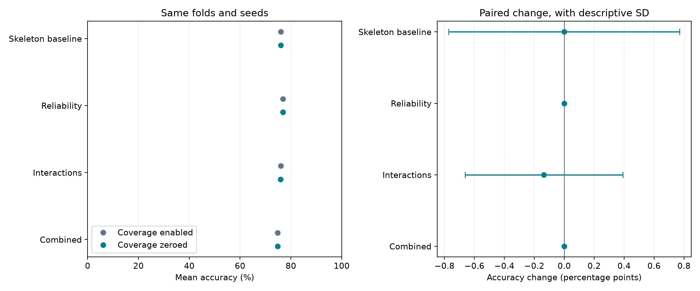

# Explicit coverage ablation

Recorded 2026-11-14.

Explicit pose-coverage input replaced with zero; head dimensions and RNG draws retained.

Matched 245 unique clips, 204 reviewed source groups, 5 folds and seeds [42, 123, 2026].
Pose/motion inputs, feature construction, splits, training budget and nominal parameter counts match. Scaling, checkpoint selection and thresholds are fitted afresh using training and validation data.

| Model | Coverage on | Coverage off | Accuracy change (pp) | Macro-F1 change | AUC change | Improved/tied/worse runs |
|---|---:|---:|---:|---:|---:|---:|
| Skeleton baseline | 76.1% | 76.1% | +0.00 | +0.000 | -0.001 | 1/13/1 |
| Reliability | 76.9% | 76.9% | +0.00 | -0.000 | +0.001 | 0/15/0 |
| Interactions | 76.1% | 75.9% | -0.14 | -0.001 | +0.002 | 0/14/1 |
| Combined | 74.8% | 74.8% | +0.00 | +0.000 | -0.001 | 0/15/0 |

Changes are coverage-off minus coverage-on. The unchanged linear controls reproduce identical held-out scores and decisions.

This is an exploratory paired comparison on previously inspected footage. Fold/seed observations are dependent; descriptive deviations and win counts are not confidence intervals or significance tests. Zeroing the explicit scalar leaves observation masks, missing joints, confidence channels and interaction counts available. It cannot establish that a model uses only body motion or eliminate all detection cues.

Both experiments were verified from saved fits: 70 reference and 70 ablation fits. The reference artifacts were read without modification.

TCN scores were reproduced on cuda; verification implementation hashes are recorded separately. See the supplemental CPU precision audit for cross-device behavior.

[Detailed comparison](coverage_comparison.json) | [Paired runs](coverage_paired_runs.csv) | [Ablation results](index.html)
