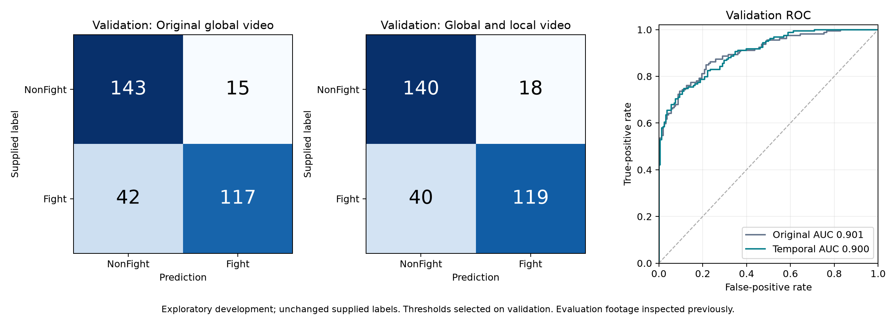

# Paired temporal video comparison

| Partition | Previous accuracy | Temporal accuracy | Old errors fixed | New errors introduced |
|---|---:|---:|---:|---:|
| validation | 82.02% | 81.70% | 12 | 13 |

This comparison uses identical clips and source groups with unchanged labels. Each head has its own validation-selected threshold. The temporal candidate and evaluation eligibility were frozen before evaluation features were read. These are exploratory development results, not an independent generalization claim.

[Changed predictions](changed_predictions.csv) | [Per-source changes](paired_comparison.json) | [Development decision](promotion.json)

