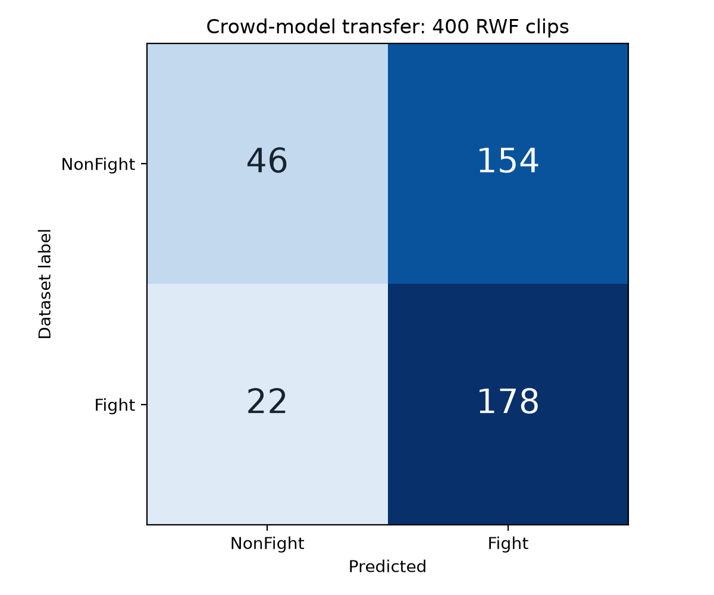

# One-time RWF-2000 transfer evaluation

Recorded 2026-11-15.

Saved model: source-corrected crowd combined_seed42. Frozen threshold: 0.54. Device: cuda.

| Evaluation | Clips | Accuracy | Macro-F1 | ROC-AUC |
|---|---:|---:|---:|---:|
| All released evaluation clips | 400 | 56.0% | 0.506 | 0.578 |
| Excluding known prior demo | 399 | 56.1% | 0.508 | 0.577 |
| Pose-supported subset (secondary) | 347 | 54.2% | 0.410 | 0.508 |

Violent precision: 0.536; recall: 0.890. Low-pose clips: 53; pose-supported coverage: 86.8%.

Evaluation wall time: 3.17 minutes. Fresh full-video decode and sampled pose extraction, cache writes/loads, fixed feature normalization and GPU classification. Includes model initialization; excludes inventory preparation and report generation. Not a cold/warm per-video latency benchmark.

Exploratory transfer of a crowd-trained classifier to the released RWF-2000 evaluation split. No RWF training, normalization fitting, checkpoint selection or threshold tuning is performed. This is different from supervised training and evaluation on RWF. Supplied labels are retained. One known clip was inspected in an earlier demo; other prior viewing and unknown shared footage cannot be ruled out. Scores are not calibrated probabilities. All clips remain in primary metrics, including low-pose cases.

All 400 released clips are retained in the primary real-data result. The pose-supported subset is secondary and selected by the pre-existing 25% usable-pose rule.

[Predictions](predictions.csv) | [Metrics](metrics.json) | [Audit](audit.json) | [Frozen protocol](protocol.json)
