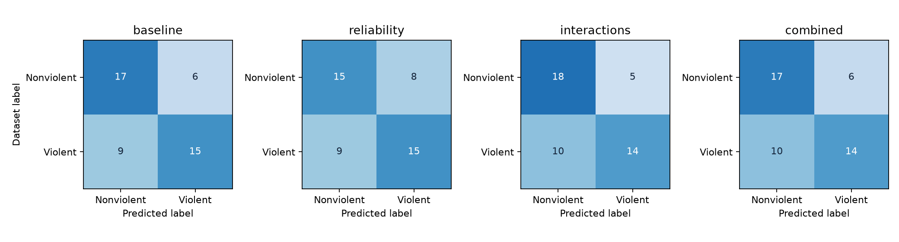

# Pilot verification and limitations

Saved artifacts passed verification.

All 242 source video hashes match the manifest. Exact stored source keys are disjoint across splits, but this does not establish source independence. All four checkpoints reproduce saved validation/test scores on CPU within 0.0003 absolute tolerance, with identical threshold decisions. The CUDA check uses 0.000001 absolute tolerance. Measured drift is saved per model in audit.json; CUDA TF32 and CPU arithmetic differ slightly. Reported metrics match the prediction CSV files. Every demo video decodes fully and has a readable poster image.

| Variant | Test accuracy | Approximate 95% interval | Accuracy with pose coverage below 25% | Accuracy with coverage at least 25% |
|---|---:|---:|---:|---:|
| baseline | 68.1% | 55.3% to 80.9% | 55.6% (n=9) | 71.1% (n=38) |
| reliability | 63.8% | 48.9% to 76.6% | 55.6% (n=9) | 65.8% (n=38) |
| interactions | 68.1% | 55.3% to 80.9% | 55.6% (n=9) | 71.1% (n=38) |
| combined | 66.0% | 53.2% to 78.7% | 44.4% (n=9) | 71.1% (n=38) |

10,000 class-stratified clip bootstrap resamples; percentile 95% intervals. These reflect this holdout only, not training-seed, fold, or source-group uncertainty.

Mean usable pose coverage is 74.3%. 31 clips fall below 25% coverage. Track selection discards some detected tracks in 199 clips. One clip's full decode length differs from its container header; extraction samples the fully decoded clip.

The models overfit quickly, so validation loss selects an early checkpoint. Do not tune thresholds on the test set, report a filtered test subset as overall accuracy, or treat small differences between variants as statistically established.

The six demos use the first three filenames from each held-out class, including abstentions and a missed violent clip. They are not selected by correctness.

Remaining research: source/label review, multiple seeds and folds, stronger motion/RGB controls, external evaluation, and annotated person-level attribution. The current system outputs a full-clip score.

## Follow-up control verification

All 242 motion caches match source hashes, frame anchors and feature settings. Both linear checkpoints reproduce every saved score and decision. Training-only normalization, validation-selected thresholds and all reported split metrics were verified. This checks saved artifacts; source and label review remains necessary.
