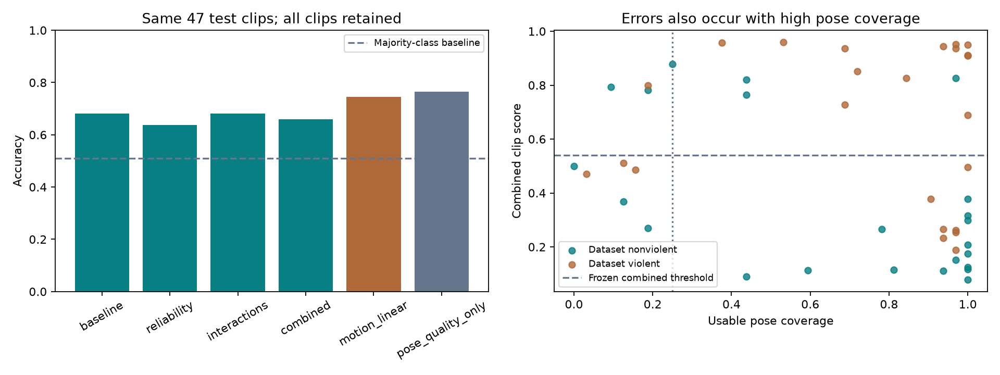

# Failure analysis and motion controls

| Model | Test accuracy | Macro-F1 | ROC-AUC |
|---|---:|---:|---:|
| baseline | 68.1% | 0.680 | 0.808 |
| reliability | 63.8% | 0.638 | 0.781 |
| interactions | 68.1% | 0.679 | 0.850 |
| combined | 66.0% | 0.658 | 0.786 |
| motion_linear | 74.5% | 0.744 | 0.766 |
| pose_quality_only | 76.6% | 0.764 | 0.873 |

Combined model: 16 errors, including 6 false positives and 10 false negatives. 11 errors occur with at least 25% usable pose coverage. All skeleton variants miss 13 of the same clips.

The 80-dimensional motion descriptor uses real adjacent decoded frames near the original 32 anchors, not flow between distant sampled frames. Train-only normalization and logistic fitting; validation log-loss selects regularization from C=0.01,0.1,1,10; validation macro-F1 selects threshold. The seven-feature quality-only control uses fixed C=1 and no joint positions or trajectories.

This follow-up is exploratory because the original pilot test results were already inspected. The test set did not select these controls' coefficients, regularization or thresholds. No skeleton checkpoint or test partition was changed.

| Skeleton model | Motion correct, skeleton wrong | Skeleton correct, motion wrong | Both wrong |
|---|---:|---:|---:|
| baseline | 14 | 11 | 1 |
| interactions | 13 | 10 | 2 |
| combined | 14 | 10 | 2 |

Cross-split triage compared 16221 video pairs; 0 passed its heuristic. Inspect similarity.json and the twelve candidate sheets before treating any pair as related source footage.

No known exact or prefix-compatible source-ID overlaps remain across this split. Other shared source footage can escape filename and image-hash checks; manual source review remains necessary.

Contact sheets cover all 47 test clips with six frames each. This is sparse visual triage; it cannot verify full-clip labels. No labels have been changed. Track observations and discarded detections are descriptive proxies, not measured tracking errors.

Next: review complete videos for suspicious labels and source overlap; validate the signal comparison across seeds and source-separated folds. If aggregate pose quality predicts violence well, investigate scene and detection confounds. Compare a stronger motion/RGB baseline before making representation-superiority claims.

