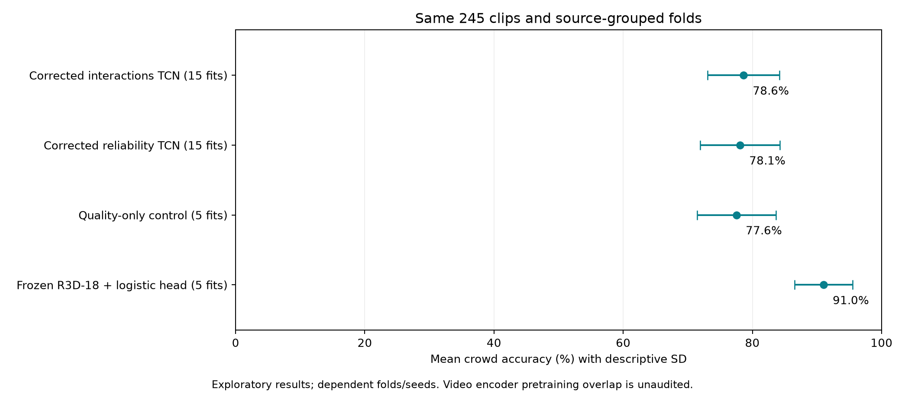

# Technical progress completed

Paper drafting remains deferred. **Technical completion is roughly 85 to 90%**, with a weighted planning estimate of about 88%. This percentage describes work completed, not prediction accuracy or deployment readiness.

| Completed work | Measured result |
|---|---|
| Continuous hip-centering correction | Artificial-motion regression fixed; 166/245 clips change features; 980 legacy feature builds remain exact. |
| Matched centering experiment | 140 verified CPU fits; interactions 76.5% to 78.6%, reliability +0.95 pp; baseline/combined do not improve. |
| Frozen pretrained video reference | 91.0% mean crowd accuracy, macro-F1 0.909, AUC 0.979; 245 clips and five verified heads. |
| GPU input controls | 45 verified fits: full 75.4%, detection-only 72.5%, shuffled derived time slices 75.4%. |
| Video-model RWF transfer | Primary fixed head 63.25% accuracy, AUC 0.712; predeclared ensemble 63.75%, AUC 0.743. All 400 clips; no RWF fitting/tuning. |
| Controlled raw-video runtime | Warm median 0.270 s, p95 0.390 s; cold process median 8.36 s. Ten fixed clips, three warm repeats. |
| Refreshed demonstration | Four corrected-interactions videos, including false positives and misses; every encoded frame decoded successfully. |
| Independent-review preparation | 40 neutral full videos prepared without predictions/class paths. Independent human review is still pending. |
| Implementation checks | 43 tests passed. Historical crowd, coverage and original RWF fitted artifacts preserved. |

The direction is supported by evidence: a pretrained video representation gives a much stronger crowd reference than the current pose-only variants. Detection cues remain predictive, ordering adds no mean benefit in this shuffle control, and both families still transfer weakly to surveillance footage. The next improvement should be a focused motion/video or fusion experiment and a separately defined external-data protocol. Existing RWF results must not become threshold/model-selection data.

These comparisons remain exploratory on inspected footage. The video baseline uses a much larger pretrained encoder; this is not a matched-capacity comparison. Pretraining/source overlap and independent label correctness remain unaudited. SD is descriptive, not a confidence interval. Runtime is offline whole-clip execution and excludes overlay/export.

[Centering comparison](../centering_corrected_cpu_20261115/centering_ablation.html) |
[Video reference](../video_baseline_v2_20261115/index.html) |
[Input controls](../input_controls_20261115/index.html) |
[Video transfer](../video_transfer_20261115/index.html) |
[Runtime](../runtime_20261115/RESULTS.md) |
[Demonstrations](../demo_20261115/index.html) |
[Neutral review pack](../blind_review_20261115/index.html) |
[Project status](../../PROJECT_STATUS.md) |
[Next work](../../NEXT_STEPS.md)
